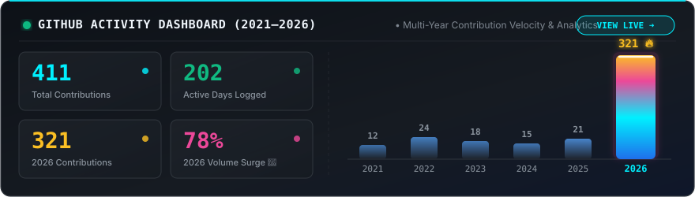

  <picture>
    <source media="(prefers-color-scheme: dark)" srcset="https://raw.githubusercontent.com/Anirbank33/Anirbank33/main/header-animation.svg?v=js1" />
    <source media="(prefers-color-scheme: light)" srcset="https://raw.githubusercontent.com/Anirbank33/Anirbank33/main/header-animation-light.svg?v=js1" />
    
  </picture>
  

    📍 Bengaluru, India &nbsp;•&nbsp; ● Open to Software Engineering Opportunities (Global Remote / Hybrid)
  

  

    
    &nbsp;
    
    &nbsp;
    
    &nbsp;
    
  

 

<!-- Skills Stream Animation -->

  <picture>
    <source media="(prefers-color-scheme: dark)" srcset="https://raw.githubusercontent.com/Anirbank33/Anirbank33/main/backend-skills-stream.svg?v=js1" />
    <source media="(prefers-color-scheme: light)" srcset="https://raw.githubusercontent.com/Anirbank33/Anirbank33/main/backend-skills-stream-light.svg?v=js1" />
    
  </picture>

 

<!-- Recruiter Tech Competency Matrix -->

  <table border="0" cellpadding="0" cellspacing="8" width="100%">
    <tr>
      <td width="25%" align="center">
        <b>💻 Languages &amp; Runtimes</b> 
        TypeScript · JavaScript (ES6+) · Java 17/21 · SQL · Python
      </td>
      <td width="25%" align="center">
        <b>⚙️ Backend &amp; Microservices</b> 
        Node.js · Express · RESTful APIs · WebSockets · OpenAPI / Zod
      </td>
      <td width="25%" align="center">
        <b>🗄️ Persistence &amp; Caching</b> 
        PostgreSQL · MongoDB · Redis (Caching/PubSub) · MySQL
      </td>
      <td width="25%" align="center">
        <b>🚀 Cloud, DevOps &amp; Quality</b> 
        Docker · Git CI/CD · Automated Testing · Clean Architecture · Linux
      </td>
    </tr>
  </table>

 

<!-- Featured Engineering Projects -->

  <table border="0" cellpadding="0" cellspacing="0" width="100%">
    <thead>
      <tr align="left">
        <th width="32%"><b>Project &amp; Repository</b></th>
        <th width="28%"><b>Tech Stack</b></th>
        <th width="40%"><b>Architecture &amp; Engineering Focus</b></th>
      </tr>
    </thead>
    <tbody>
      <tr>
        <td>
          <b><a href="https://github.com/Anirbank33/jarvis-ai-assistant">⚡ JARVIS Voice &amp; Desktop OS</a></b> 
          <a href="https://github.com/Anirbank33/jarvis-ai-assistant">[Repo ↗]</a>
        </td>
        <td><code>TypeScript</code> <code>React 18</code> <code>Node.js</code> <code>Gemini AI</code></td>
        <td>Futuristic AI Voice OS for macOS with real-time speech, neural reasoning, system telemetry &amp; security gateway</td>
      </tr>
      <tr>
        <td>
          <b><a href="https://github.com/Anirbank33/medical-department-tracker">🏥 Wardline Medical Operations</a></b> 
          <a href="https://github.com/Anirbank33/medical-department-tracker">[Repo ↗]</a>
        </td>
        <td><code>React 18</code> <code>TypeScript</code> <code>Express</code> <code>Zod</code></td>
        <td>Enterprise hospital patient census &amp; ward operations tracker with OpenAPI contract codegen and runtime validation</td>
      </tr>
      <tr>
        <td>
          <b><a href="https://github.com/Anirbank33/backend-demo">🚀 Document REST API Engine</a></b> 
          <a href="https://github.com/Anirbank33/backend-demo">[Repo ↗]</a>
        </td>
        <td><code>Node.js</code> <code>Express</code> <code>Clean Architecture</code> <code>Supertest</code></td>
        <td>Production-grade RESTful microservice with layered architecture, per-IP rate limiting, atomic I/O, and 16 passing tests</td>
      </tr>
      <tr>
        <td>
          <b><a href="https://github.com/Anirbank33/github-activity-2021-2026">📊 GitHub Activity Telemetry</a></b> 
          <a href="https://anirbank33.github.io/github-activity-2021-2026/" target="_blank">[Live Demo ↗]</a> · <a href="https://github.com/Anirbank33/github-activity-2021-2026">[Repo ↗]</a>
        </td>
        <td><code>JavaScript</code> <code>Canvas</code> <code>GitHub API</code> <code>CSS Themes</code></td>
        <td>Multi-year commit analytics &amp; interactive telemetry dashboard with automated dark/light theme persistence</td>
      </tr>
      <tr>
        <td>
          <b><a href="https://github.com/Anirbank33/java-core-troubleshooting">☕ Java Core Diagnostics Suite</a></b> 
          <a href="https://github.com/Anirbank33/java-core-troubleshooting">[Repo ↗]</a>
        </td>
        <td><code>Java 17/21</code> <code>Streams API</code> <code>Clean OOP</code> <code>Optional</code></td>
        <td>Rigorous enterprise troubleshooting case study and modern refactored solution for compile-time, runtime &amp; logic faults</td>
      </tr>
      <tr>
        <td>
          <b><a href="https://github.com/Anirbank33/portfolio">🌐 Official Portfolio &amp; Terminal CLI</a></b> 
          <a href="https://anirbank33.github.io/portfolio/" target="_blank">[Live Site ↗]</a> · <a href="https://github.com/Anirbank33/portfolio">[Repo ↗]</a>
        </td>
        <td><code>HTML5</code> <code>Modern CSS</code> <code>Vanilla JS</code> <code>CLI Terminal</code></td>
        <td>High-performance portfolio website featuring interactive browser CLI, 4-node architecture visualizer &amp; live GitHub sync</td>
      </tr>
    </tbody>
  </table>

 

<!-- Engineering Activity Telemetry -->

  <a href="https://anirbank33.github.io/github-activity-2021-2026/" target="_blank">
    <picture>
      <source media="(prefers-color-scheme: dark)" srcset="https://raw.githubusercontent.com/Anirbank33/Anirbank33/main/activity-preview.svg" />
      <source media="(prefers-color-scheme: light)" srcset="https://raw.githubusercontent.com/Anirbank33/Anirbank33/main/activity-preview-light.svg" />
      
    </picture>
  </a>
  

    
      <b><a href="https://anirbank33.github.io/github-activity-2021-2026/" target="_blank">⚡ Open Live Dashboard ↗</a></b>
      &nbsp;&nbsp;•&nbsp;&nbsp;
      <b><a href="https://github.com/Anirbank33/github-activity-2021-2026" target="_blank">📦 Activity Repo ↗</a></b>
      &nbsp;&nbsp;•&nbsp;&nbsp;
      <b><a href="https://github.com/Anirbank33/Anirbank33/blob/main/github-activity-2021-2026.html" target="_blank">📄 Direct Source ↗</a></b>
    
  

 

<!-- Space Galaga Arcade Contribution Game (Single Aesthetic Showcase) -->

  <picture>
    <source media="(prefers-color-scheme: dark)" srcset="https://raw.githubusercontent.com/Anirbank33/Anirbank33/main/galaga-header.svg?v=1" />
    <source media="(prefers-color-scheme: light)" srcset="https://raw.githubusercontent.com/Anirbank33/Anirbank33/main/galaga-header-light.svg?v=1" />
    
  </picture>

 

  <picture>
    <source media="(prefers-color-scheme: dark)" srcset="https://raw.githubusercontent.com/Anirbank33/Anirbank33/output/galaga-contribution-graph-dark.svg?v=1" />
    <source media="(prefers-color-scheme: light)" srcset="https://raw.githubusercontent.com/Anirbank33/Anirbank33/output/galaga-contribution-graph.svg?v=1" />
    
  </picture>
  

    <code>Galaga Interceptor ──► Alien Ingress Defense ──► 52-Week GitHub Commits ──► 12h Live Telemetry</code>
  

 

<!-- GitHub Metrics & Language Distribution -->

  <picture>
    <source media="(prefers-color-scheme: dark)" srcset="https://ghstats.vercel.app/api?username=Anirbank33&show_icons=true&theme=transparent&hide_border=true&title_color=00F0FF&icon_color=EC4899&text_color=C9D1D9&rank_icon=github" />
    <source media="(prefers-color-scheme: light)" srcset="https://ghstats.vercel.app/api?username=Anirbank33&show_icons=true&theme=transparent&hide_border=true&title_color=0284C7&icon_color=DB2777&text_color=334155&rank_icon=github" />
    
  </picture>
  &nbsp;&nbsp;
  <picture>
    <source media="(prefers-color-scheme: dark)" srcset="https://ghstats.vercel.app/api/top-langs/?username=Anirbank33&layout=compact&theme=transparent&hide_border=true&title_color=00F0FF&text_color=C9D1D9&langs_count=6" />
    <source media="(prefers-color-scheme: light)" srcset="https://ghstats.vercel.app/api/top-langs/?username=Anirbank33&layout=compact&theme=transparent&hide_border=true&title_color=0284C7&text_color=334155&langs_count=6" />
    
  </picture>

 

<!-- Footer Connect -->

  

    <b>Let's build scalable, resilient web applications &amp; distributed backend systems together.</b> 
    Open to Full-Stack, Backend, Node.js, TypeScript &amp; Java Software Engineering opportunities (Global Remote &amp; Hybrid).
  

  
  &nbsp;&nbsp;
  
  &nbsp;&nbsp;
  
  &nbsp;&nbsp;
  

